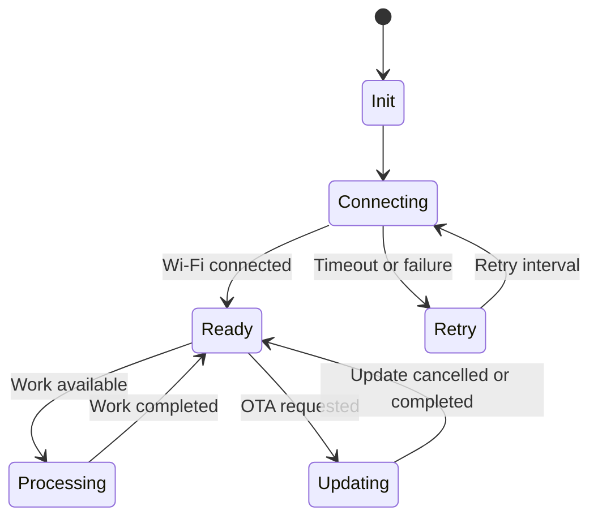

# Recommended ESP32-S3 topics to cover before external components

I reviewed your [Arduino-Documentation repository](https://github.com/ooikk/Arduino-Documentation/tree/main), including its main README and the 02_MISC topic index. You have already covered a substantial amount of ESP32-specific material, so I would avoid adding more basic GPIO and peripheral tutorials for now. Instead, I recommend a short advanced-foundations module covering how the ESP32-S3 operates internally, how to build reliable firmware, and how to use its built-in capabilities.

Your repository already includes topics such as GPIO and pin assignment, hardware information and memory, I²C, SPI, UART, I²S, bootloader troubleshooting, hardware timers, interrupts, sleep modes, saving settings in NVS, CPU cores, Wi-Fi, Bluetooth, ESP-NOW, MQTT, OTA, and cloud integrations.

The 02_MISC index specifically lists CPU Core, Sleep Mode, Interrupt, Hardware Timer, Saving User Setting, OTA Update, Wi-Fi, Bluetooth, ESP-NOW and several cloud/networking topics. [View your 02_MISC index](https://github.com/ooikk/Arduino-Documentation/blob/main/02_MISC/Readme.md).

## 1. My recommended additions, ranked by value

These recommendations are compared against the topics visible in your repository index and README. “New” means a distinct topic not apparent in that index, rather than a guarantee that no related material exists anywhere in the repository.

### 1. FreeRTOS multitasking and synchronization

**Highest priority**  
**New depth beyond CPU Core**

You already have a CPU Core topic. The next step is learning how software actually uses the cores.

Cover task creation and priorities, task states, scheduling, task pinning, queues, semaphores, mutexes, task notifications, race conditions and watchdogs.

**Practical lab:** one task acquires data, another processes it, and a third reports results. Run tasks on separate cores and protect shared data correctly.

**Why it matters:** this becomes useful in almost every non-trivial sensor, motor, display or network project.

### 2. Memory management, heap, stack and PSRAM

**Builds on existing hardware-information material**

Your README already covers flash size, PSRAM size, free heap, sketch size and partition schemes. Extend this into runtime memory management: stack versus heap, fragmentation, allocation failure, task stack sizing, internal RAM versus PSRAM, and memory leaks.

**Practical lab:** allocate and release buffers of different sizes, observe free heap and largest allocatable blocks, and compare internal RAM with PSRAM.

This is particularly valuable on your N16R8 board, which has 16 MB flash and 8 MB PSRAM.

### 3. Watchdogs, reset reasons and crash diagnosis

**Distinct reliability topic**

Explain the task watchdog, interrupt watchdog, reset causes, panic output, backtraces, stack overflow and common causes of reboot loops.

**Practical lab:** intentionally block a task, trigger a watchdog event, capture the serial output, then correct the problem.

This builds on your bootloader troubleshooting topic but focuses on failures after firmware has started running.

### 4. Hardware acceleration: DMA, RMT and LEDC

**New feature-focused module**

Explain the difference between CPU-driven operations and hardware-assisted operations.

- **DMA:** moves data between memory and supported peripherals with less CPU involvement.
- **RMT:** generates or captures precisely timed signal sequences.
- **LEDC:** hardware PWM generation for brightness and control signals.

**Practical lab:** compare software-timed pulses with RMT, and compare blocking output with hardware PWM.

This is an excellent bridge into motors, addressable LEDs, pulse sensors and communication protocols.

### 5. Native USB: CDC, HID, MSC and USB host

**Builds on your USB and bootloader notes**

Your README already explains the USB-to-UART bridge versus the ESP32-S3 native USB connection. The next step is a feature-oriented tutorial on USB device classes, USB descriptors, CDC serial, HID keyboard/mouse, mass storage, host mode and the limits of each mode.

**Practical lab:** create a native USB CDC device, then a separate HID demonstration. Keep the USB-to-UART upload and debugging path clearly distinguished.

### 6. ESP32 security fundamentals

**Extends OTA and HTTPS**

You have already worked with HTTPS, TLS certificates, SHA-256 and OTA. Broaden this to the difference between integrity and authenticity, certificate validation, credential storage, secure boot, flash encryption, firmware signing and threat models.

**Practical lab:** demonstrate how a valid TLS connection differs from an insecure connection, and verify a firmware hash before installation.

Explain that a SHA-256 hash obtained from an untrusted manifest does not by itself authenticate the firmware publisher.

## 2. Other worthwhile ESP32-specific topics

These are also valuable, but I would place them after the six above.

| Priority | Topic | What to teach | Relationship to your current material |
|---|---|---|---|
| 7 | ESP-IDF versus Arduino-ESP32 | How Arduino runs on ESP-IDF, using ESP-IDF APIs from Arduino, event loops, components and version compatibility | Extends your Arduino IDE and framework setup |
| 8 | Interrupt design and deferred processing | ISR restrictions, `IRAM_ATTR`, `volatile` versus atomics, ISR-safe queues and task notifications | Builds on your existing Interrupt topic; focus on advanced pitfalls |
| 9 | Power management and wake-up sources | Light sleep versus deep sleep, wake-up causes, retained data, timer/GPIO wake-up, power measurement | Extends Sleep Mode |
| 10 | Flash storage and filesystem design | NVS versus LittleFS/SPIFFS/FATFS, wear levelling, flash write limitations and data logging | Extends NVS settings and partition schemes |
| 11 | Wi-Fi internals and resilient networking | Station/AP modes, reconnect strategy, event callbacks, RSSI, DHCP, mDNS, DNS and connection state machines | Builds on Wi-Fi and cloud integration |
| 12 | Bluetooth Low Energy (BLE) architecture | GATT services/characteristics, client/server roles, notifications, pairing and bonding | Extends your Bluetooth topic, assuming BLE fundamentals are already covered |
| 13 | Debugging with JTAG and hardware tools | Breakpoints, watchpoints, backtraces, logic analysers and oscilloscope-based timing checks | Extends serial debugging and bootloader troubleshooting |
| 14 | ESP32-S3 signal routing and peripheral allocation | GPIO matrix, IO MUX, peripheral pin selection, signal conflicts and resource limitations | Complements your GPIO-by-GPIO guide |
| 15 | Watchdog-safe firmware architecture | State machines, non-blocking design, timeouts and recovery paths | Can be combined with Topic 3 if you want fewer lessons |

The Arduino-ESP32 framework provides hardware-specific libraries for features such as RMT, timers, USB, Wi-Fi, Bluetooth, filesystems and OTA. That makes these good candidates for a feature-focused learning sequence.

## 3. Topics I would not prioritize yet

You already have a good base, so I would avoid spending much more time on:

- Basic GPIO output/input, button handling and PWM fundamentals.
- Introductory I²C, SPI and UART tutorials.
- Another general overview of flash, PSRAM or partition tables.
- Another basic OTA walkthrough or introductory Wi-Fi/cloud integration.
- More simple display and RFID examples before consolidating the core firmware concepts.

These subjects are still important, but they are either already represented in your repository or are better learned through practical projects using external components.

## 4. Suggested learning sequence

I would add the following short sequence to your 02_MISC section before starting the sensor and motor modules.

### ESP32-S3 advanced foundations

**Suggested order for your learning repository**

1. **FreeRTOS and dual-core programming** — tasks, scheduling, queues, mutexes and shared data.
2. **Memory management** — heap, stack, fragmentation, PSRAM and allocation failures.
3. **Watchdogs and crash diagnosis** — reset reasons, panic output, backtraces and recovery.
4. **Hardware acceleration** — DMA, RMT and LEDC.
5. **Native USB features** — CDC, HID, MSC and host/device modes.
6. **Security fundamentals** — TLS, secure firmware updates, secure boot and flash encryption.
7. **ESP-IDF architecture** — components, event loops and using ESP-IDF APIs from Arduino.

This sequence moves from how the firmware executes, to how it manages resources, to how it interacts with hardware and protects itself. It also gives you useful foundations for more complex external-component projects.

## 5. One additional topic that is especially useful: firmware state machines

Although this is a software design technique rather than a unique ESP32 peripheral, I would strongly recommend a dedicated lesson on non-blocking state machines.

For example, instead of using long sequences of `delay()` calls for a Wi-Fi connection, sensor reading, motor operation and cloud upload, design explicit states:

A state-machine approach makes firmware easier to test, debug and recover. It also helps avoid long blocking operations that interfere with communications, watchdogs and time-sensitive tasks.

## My final recommendation

If you want to keep the repository focused, add six core lessons first: FreeRTOS, memory management, watchdogs and crash diagnosis, DMA/RMT/LEDC, native USB, and security. You already have enough introductory GPIO and communication material to move beyond the basics.

Then start your external-component series with sensors and actuators, applying these foundations as needed rather than trying to master every advanced ESP32 feature before building projects.
